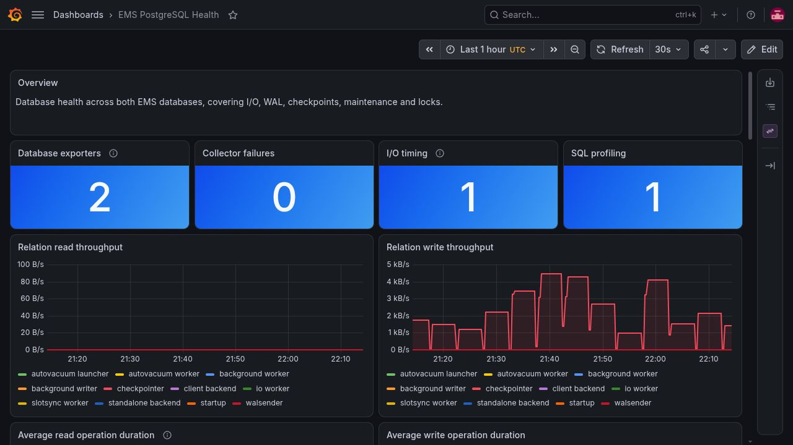
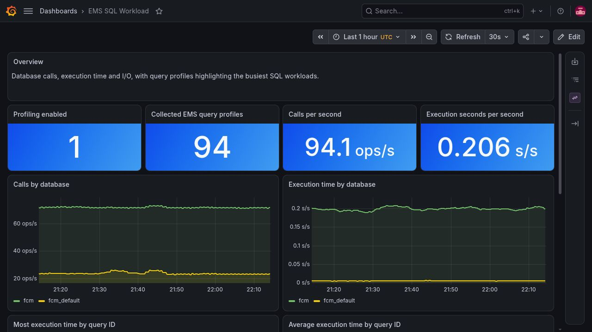
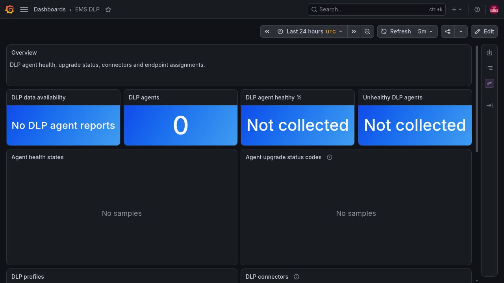

# FortiClient EMS Docker Dashboards — EMS 8.0

Grafana, Prometheus and Loki monitoring for **EMS 8.0.1.0192 with the bundled PostgreSQL 18 database**. This branch contains the version-matched nginx templates, exporters and 16 dashboards.

| EMS deployment | Configuration | Guide |
| --- | --- | --- |
| 7.4.7 / PostgreSQL 15 | [ems-7.4](https://github.com/user01010111/FortiClientEMS-DockerDash/tree/ems-7.4) | [EMS 7.4](https://forti.blog/guides/forticlient-ems-7-4-observability-guide) |
| 8.0.1.0192 / PostgreSQL 18 | **ems-8.0 (this branch)** | [EMS 8.0.1](https://forti.blog/guides/forticlient-ems-8-0-1-observability-guide) |

The default `main` branch retains the 7.4 configuration. Select the branch matching your EMS deployment; switching branches does not upgrade EMS or migrate its database.

## Dashboards

The override exposes bundled Grafana at `https://<fqdn>/grafana/`, provisions its four datasources, and adds Prometheus, node-exporter, cAdvisor, PostgreSQL/Redis/PgBouncer/Consul/nginx exporters and internal probes. No metrics ports are published on the host.

| Dashboard | Coverage |
| --- | --- |
| EMS Fleet Overview | Endpoint counts, operating systems and client versions |
| EMS Security Posture | Protection, detections, severity and vulnerability publication dates |
| EMS Policies & ZTNA | Policies, certificates and posture |
| EMS Admin & Licensing | Admin activity, alerts, licensing and hotfix availability/scheduling |
| EMS Software Inventory | Packages, vendors, governance, application-control blocks and usage |
| EMS DLP | Agent health, upgrade codes, profiles, connector errors/expiry and assignments |
| EMS Stack Overview | Service and resource overview |
| EMS Host Health | Host capacity and utilisation |
| EMS Datastores | PostgreSQL, Redis and PgBouncer |
| EMS PostgreSQL Health | PostgreSQL 18 I/O, WAL, checkpoints, contention and maintenance |
| EMS SQL Workload | Calls and execution/I/O time by database and bounded query IDs |
| EMS Containers | Per-service resources and observed start-time changes |
| EMS Control Plane | Supporting services |
| EMS Reverse Proxy | nginx metrics and logs |
| EMS Operations | Four internal HTTP/HTTPS probes and fileserver TCP reachability |
| EMS Service Logs | Loki streams and error-rate views |

<details>
<summary>PostgreSQL 18 and licence-dependent dashboard examples (UTC)</summary>





</details>

### Licence-dependent data

Keep all dashboards installed on trial and ZTNA-only deployments. Software inventory, usage/governance, DLP, AV and vulnerability metadata need the corresponding licence, enabled features and endpoint reports. Empty tables are expected when those features supply no data. DLP health percentages and usage totals show **Not collected** rather than presenting an empty deployment as fully healthy.

The project textbox defaults to `.+` so the vendor default `fcems` and custom names both work. Narrow it to your Compose project when multiple stacks share a host.

Business SQL panels target `vdom_id = 1`; adjust that filter for another site. Prevalence and affected-endpoint panels deduplicate client-user reports through the physical client ID. Software row counts remain report counts. Unknown vendor status codes remain codes. Missing severity/publication dates remain Unknown. Publication age is not the time an endpoint has been exposed.

## Install or update monitoring

Start with the [matching vendor EMS deployment](https://docs.fortinet.com/document/forticlient/8.0.1/ems-administration-guide/532081/deploying-ems-with-docker-compose). This repository does not migrate PostgreSQL data.

1. Back up the existing Compose files, `.env`, custom files and Grafana state. Take a complete VM recovery point and SQL backups before an EMS/database upgrade.
2. Clone the version branch beside `docker-compose.yaml`:

   ```bash
   git clone --branch ems-8.0 https://github.com/user01010111/FortiClientEMS-DockerDash.git FortiClientEMS-DockerDash
   ```

   Merge the example `FQDN` and `GF_ADMIN_PASSWORD` into the existing `.env`; preserve its database password and instance name. The Grafana admin variable bootstraps a new instance; it does not reset a stored password.
3. Link the override from the EMS Compose directory:

   ```bash
   ln -s FortiClientEMS-DockerDash/docker-compose.override.yml docker-compose.override.yml
   docker compose config --quiet
   ```

   Merge an existing override rather than replacing it. Preserve instance-specific volume names, especially a separately migrated PostgreSQL volume. Adjust bind paths if the checkout directory differs.

4. The override adds statement preload and I/O/WAL/vacuum-delay timing to the database command. Preserve other required vendor/local command options. Applying these options **restarts PostgreSQL**. In a maintenance window:

   ```bash
   docker compose stop
   docker compose up -d --no-deps db
   docker compose exec -T db pg_isready -U postgres
   ```

   Wait for readiness. Check the vendor-installed statistics extension before starting monitoring:

   ```bash
   docker compose exec -T db psql -U postgres -d fcm_default -c \
     'SELECT count(*) FROM addons.pg_stat_statements;'
   docker compose up -d
   docker compose ps
   docker compose exec -T nginx nginx -t
   ```

   Diagnose extension/schema/preload errors against the matching EMS image; do not recreate EMS databases to fix statistics. Services may wait for deploy and DAS readiness. Grafana reloads dashboard-only JSON edits automatically; no service restart is needed.

For shared deployments, replace the lab's existing `postgres` login in the Grafana and exporter environment with dedicated roles. Limit the Grafana reader to the tables/columns used by the dashboards and grant the exporters the required statistics permissions. Keep passwords in the deployment environment, outside Git.

## PostgreSQL collection

The `postgres` target connects to `fcm_default` and owns server-wide counters and statement profiles. The second `postgres-fcm` target collects only table/index and maintenance statistics from `fcm`, avoiding duplicated transaction/cache metrics. Sqitch and site-template schemas are excluded from table series.

The exporter uses the tested upstream **0.19.1 image digest**. Native collectors provide checkpoints, transaction age/wraparound and statement profiles. `postgres/queries-global.yml` adds PG18 I/O/WAL/parallel fields; `queries-database.yml` aggregates maintenance in each database's active `public` tables. The primary entrypoint concatenates those independent mappings.

The pinned exporter's custom-query interface is deprecated upstream but supported in this version. Reusing it avoids another collector service or a custom exporter implementation. Revalidate the mappings on exporter upgrades and replace them with native collectors when equivalent coverage is available.

- PostgreSQL 16 introduced `pg_stat_io`; 17 split checkpoint statistics; 18 adds actual I/O bytes/WAL rows, completed-checkpoint/SLRU fields, maintenance-duration totals and parallel-worker counters.
- Timing has overhead; compare under your workload before using these settings in production. Asynchronous/batched operation timing is not necessarily physical disk-request latency. Maintenance elapsed time includes cost-delay sleeps; tuple counts are estimates.
- Statement text is **not exported**. The native collector selects at most 100 query profiles. This is neither an exhaustive audit trail nor HTTP request-latency measurement.
- Rates need two scrapes and must respect counter resets. Startup, restores and upgrades affect the observation window.

Sources: [PG statistics](https://www.postgresql.org/docs/18/monitoring-stats.html), [statement profiling](https://www.postgresql.org/docs/18/pgstatstatements.html), [exporter v0.19.1](https://github.com/prometheus-community/postgres_exporter/tree/v0.19.1).

## nginx, probes and startup

Both nginx templates come from `ems_nginx:8.0.1.0192`. The main template adds an unpublished `18080` status listener. The HTTPS template preserves vendor routes and adds full Grafana access/WebSockets through the separate Grafana container. Its Grafana CSP does not relax the EMS application's CSP.

Compare both templates on future upgrades. The old monolithic 7.4.7 template would bypass 8.0.1's separate sites, fileserver and changed installer-download handling.

HTTPS probes use Docker names and skip certificate validation: they test internal routes, not public DNS/TLS or remote-client access. The fileserver probe tests TCP `30443`, not an authenticated download. The service root and `/metrics` return 404; those responses alone are not faults.

Grafana's enabled internal metrics endpoint is already unauthenticated here. nginx returns 404 for `/grafana/metrics`; Prometheus scrapes the Grafana container directly. Static Prometheus configuration needs no Grafana admin password. Configure client authentication separately if you explicitly protect that metrics endpoint.

The Redis entrypoint waits for the vendor's shared authentication file, preserving authenticated startup when Docker restarts services without Compose dependency ordering.

## Verification

```bash
docker compose config --quiet
docker compose exec -T nginx nginx -t
docker compose exec -T prometheus promtool check config /etc/prometheus/prometheus.yml
docker compose exec -T prometheus wget -qO- http://localhost:9090/api/v1/targets
```

Check `pg_up`, `pg_exporter_last_scrape_error` and `pg_scrape_collector_success` for both exporters. Connection health alone does not establish collector success. This layout has **17 scrape targets, five synthetic probes and 16 dashboards**. Allow two 30-second scrapes before judging new rates.

Datasource health uses GET; these commands prompt for the password rather than embedding it in a URL:

```bash
curl --fail --user admin https://<fqdn>/grafana/api/datasources/uid/ems-prometheus/health
curl --fail --user admin https://<fqdn>/grafana/api/datasources/uid/ems-fcm/health
curl --fail --user admin https://<fqdn>/grafana/api/datasources/uid/ems-fcm-default/health
curl --fail --user admin https://<fqdn>/grafana/api/datasources/uid/ems-loki/health
curl --fail --user admin 'https://<fqdn>/grafana/api/search?type=dash-db'
```

Inspect response bodies and panels too. Fix provisioning/query errors rather than deleting `grafana.db`, which also contains users, preferences, UI edits and alerting state.

Test licence-dependent SQL on the native EMS PostgreSQL host:

```bash
python3 FortiClientEMS-DockerDash/tests/check_licensed_panels.py \
  --container "$(docker compose ps -q db)"
```

The 50 cases use TEMP tables shaped from the actual schema, explicit fixture IDs and rollback. They cover empty/populated branches, Unknown states and site filtering without inserting vendor records or consuming vendor sequences. They validate SQL behaviour, not fully licensed endpoint ingestion.

## Upgrading and rollback

Do not merely change image tags across a PostgreSQL major upgrade. Back up **all EMS databases, including `template_fcm_site`**: inventories excluding template-marked databases miss it. Preserve roles/extensions, restore into a separate volume, verify the restore before EMS migration and retain a complete VM checkpoint.

For monitoring-only rollback, restore the prior configuration and Grafana state, then recreate affected services. Reverting database command options needs a restart. Never use `docker compose down -v` or discard existing volumes. A completed EMS upgrade requires consistent full-system recovery, not an older image tag alone.

## Files

- `docker-compose.override.yml`: vendor overlay and statistics options.
- `nginx/`: version-matched main and HTTPS templates.
- `redis/wait-auth.sh`: authenticated boot-order guard.
- `postgres/`: PG18 SQL mappings and exporter entrypoint.
- `prometheus/`: static scrape configuration and probe modules.
- `grafana/`: provisioning and 16 dashboard JSON files.
- `tests/check_licensed_panels.py`: native SQL regression checks.

Only built-in Grafana panels are used. Review screenshots for endpoint names, addresses and request details before publication.
